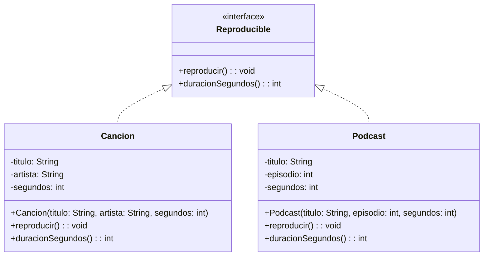
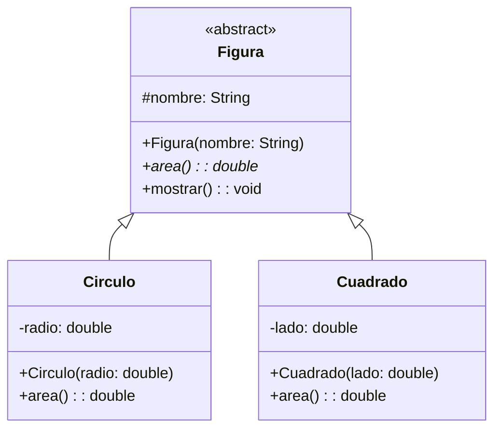
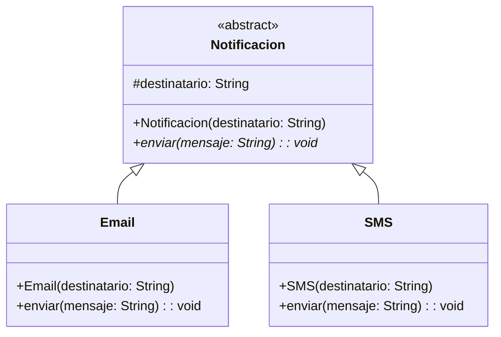
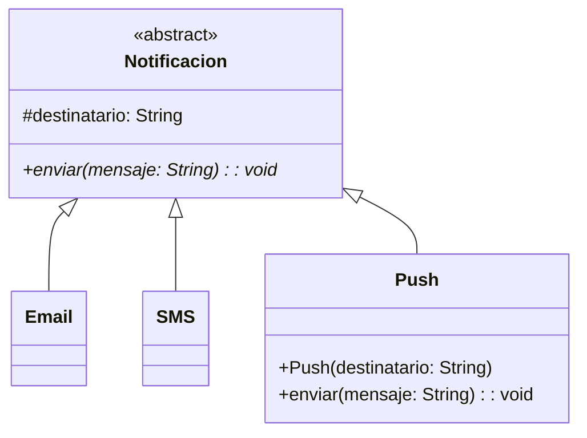

# Prácticas de clase · Semana 11

Cinco prácticas para hacer en clase: **dos de clases abstractas e interfaces**, **dos de polimorfismo y enlace dinámico**, y **una de decisión de diseño**.
Cada una tiene un caso, su diagrama UML, los pasos a seguir y la salida que debes obtener.

**Cómo trabajar cada práctica**

1. Lee el caso y mira el diagrama UML: es el **diseño completo** de lo que debes programar (`-` atributo privado, `#` atributo protegido, `+` constructor o método público, `*` método abstracto).
2. Crea un proyecto (o una carpeta) nuevo en tu IDE.
3. Sigue los pasos en orden: primero la interfaz o la clase abstracta, luego las clases que la cumplen, al final el `Main`.
4. Comprueba que tu código tenga **todo lo que muestra el diagrama**: mismos atributos, constructores y métodos.
5. Compara tu salida con la **salida esperada**.
6. Responde la pregunta final con tus palabras.

---

# Parte 1 · Clases abstractas e interfaces

> **La pregunta de esta semana:** ¿lo que comparten estas clases es **código** o solo una **capacidad**? Si es código, clase abstracta. Si es solo la capacidad, interfaz.

## Práctica 1 · `Reproducible` – `Cancion` – `Podcast` (interfaz)

**Caso:** una aplicación reproduce canciones y pódcast. Una canción tiene título y artista; un pódcast tiene título y número de episodio. No comparten ningún atributo ni ninguna línea de código, pero la aplicación necesita tratarlos igual: reproducirlos y sumar su duración.



**Pasos**

1. Crea la interfaz `Reproducible` con las dos cabeceras: `void reproducir();` e `int duracionSegundos();`. **Sin modificadores y sin llaves**, terminan en punto y coma.
2. Crea `Cancion` con sus tres atributos privados y su constructor, y escribe `implements Reproducible` en la cabecera.
3. Implementa los dos métodos con `@Override`. `reproducir()` imprime `"Cancion: " + titulo + " - " + artista`.
4. Crea `Podcast` igual, pero su `reproducir()` imprime `"Podcast: " + titulo + " (ep. " + episodio + ")"`.
5. En `Main`, declara el arreglo con el tipo de la **interfaz**: `Reproducible[] lista = { ... };`
6. Recorre el arreglo con un `for`, llama a `reproducir()` y acumula `duracionSegundos()` en una variable `total`.
7. Imprime el total al final.

**Salida esperada**

```
Cancion: Contigo Peru - Coro Nacional
Podcast: Historia del Peru (ep. 12)
Duracion total: 2010 segundos
```

**Piensa:** el `Main` nunca escribe la palabra `Cancion` ni `Podcast` dentro del bucle. ¿Cómo sabe entonces cuál `reproducir()` ejecutar en cada vuelta?

---

## Práctica 2 · `Figura` – `Circulo` – `Cuadrado` (clase abstracta)

**Caso:** el mismo problema, pero ahora **sí** hay algo común. Todas las figuras tienen un nombre y todas se muestran igual: `"nombre -> area: valor"`. Lo único que cambia es la fórmula del área.



**Pasos**

1. Crea `Figura` como `public abstract class`, con `protected String nombre;` y su constructor.
2. Declara `public abstract double area();` — **sin llaves**, con punto y coma. Aquí no hay fórmula posible.
3. Escribe `mostrar()` **con cuerpo**: imprime `nombre + " -> area: " + area()`. Fíjate en que llama a un método que todavía no existe.
4. Crea `Circulo` con `extends Figura`, su `radio`, y un constructor que haga `super("Circulo");`.
5. Sobrescribe `area()` con `@Override` devolviendo `Math.PI * radio * radio`.
6. Crea `Cuadrado` igual, con `super("Cuadrado");` y `lado * lado`.
7. En `Main`: arreglo `Figura[]` con un círculo de radio `2.0` y un cuadrado de lado `3.0`. Recórrelo llamando a `mostrar()` y acumulando `area()`.

**Salida esperada**

```
Circulo -> area: 12.566370614359172
Cuadrado -> area: 9.0
Area total: 21.566370614359172
```

**Piensa:** `mostrar()` está escrito en `Figura` y llama a `area()`, que en `Figura` **no tiene cuerpo**. ¿Por qué no es un error? ¿Qué método se ejecuta realmente, y en qué momento se decide?

---

## Práctica 3 · Decisión de diseño: ¿abstracta o interfaz?

**Caso:** no hay que programar nada nuevo. Vuelve a las prácticas 1 y 2 y responde por escrito.

| | Práctica 1 (`Reproducible`) | Práctica 2 (`Figura`) |
|---|---|---|
| ¿Qué comparten las clases? | | |
| ¿Hay código repetido que se pueda subir? | | |
| ¿Se eligió interfaz o clase abstracta? | | |
| ¿Por qué esa y no la otra? | | |

**Pasos**

1. Llena la tabla con tus palabras.
2. Intenta convertir `Figura` en una interfaz. ¿Dónde pondrías el atributo `nombre`? ¿Y el método `mostrar()` con su cuerpo?
3. Intenta convertir `Reproducible` en una clase abstracta. ¿Qué pasaría si mañana `Cancion` tuviera que heredar también de una clase `ArchivoMultimedia`?
4. Escribe en una sola frase la regla que usarías de ahora en adelante.

**Piensa:** una clase hereda de **una sola** clase base, pero puede firmar **todas** las interfaces que quiera. ¿Cómo debería pesar eso en tu decisión?

---

# Parte 2 · Polimorfismo y enlace dinámico

## Práctica 4 · `Notificacion` – `Email` – `SMS` (enlace dinámico)

**Caso:** un sistema avisa a los alumnos de que su nota está publicada. Puede hacerlo por correo o por mensaje de texto. El SMS tiene un límite: si el mensaje pasa de 20 caracteres, lo corta y añade puntos suspensivos.



**Pasos**

1. Crea `Notificacion` abstracta con `protected String destinatario;`, su constructor y `public abstract void enviar(String mensaje);`.
2. Crea `Email extends Notificacion`. Su `enviar()` imprime `"[EMAIL] para " + destinatario + ": " + mensaje`.
3. Crea `SMS extends Notificacion`. Su `enviar()` recorta primero:
   `String corto = mensaje.length() > 20 ? mensaje.substring(0, 20) + "..." : mensaje;`
4. En `Main` declara **una sola variable**: `Notificacion n;`
5. Asígnale `new Email("ana@usil.pe")` y llama a `n.enviar("Su nota ya esta publicada en Canvas")`.
6. Reasigna la **misma variable** a `new SMS("987654321")` y escribe **exactamente la misma línea** `n.enviar(...)`.

**Salida esperada**

```
[EMAIL] para ana@usil.pe: Su nota ya esta publicada en Canvas
[SMS] para 987654321: Su nota ya esta publ...
```

**Piensa:** las dos llamadas a `n.enviar(...)` son líneas de código **idénticas** y producen salidas distintas. El compilador solo sabe que `n` es una `Notificacion`. ¿Quién decide, y en qué momento, cuál de los dos `enviar()` se ejecuta?

---

## Práctica 5 · Agregar `Push` sin tocar el `Main` (extensibilidad)

**Caso:** la universidad ahora también manda notificaciones push a la app del alumno. Es la prueba de fuego: ¿tu diseño de la práctica 4 aguanta un canal nuevo?



**Pasos**

1. Parte de tu código de la práctica 4. **No borres nada.**
2. Cambia el `Main`: en vez de una variable suelta, crea un arreglo `Notificacion[] canales` con el `Email` y el `SMS`, y recórrelo con un `for` llamando a `enviar(...)`.
3. Comprueba que la salida es la misma que antes.
4. **Ahora** crea la clase `Push extends Notificacion`. Su `enviar()` imprime `"[PUSH] dispositivo " + destinatario + ": " + mensaje`.
5. Agrega `new Push("iPhone-de-Ana")` al arreglo. **No toques el bucle.**
6. Vuelve a ejecutar.

**Salida esperada**

```
[EMAIL] para ana@usil.pe: Su nota ya esta publicada en Canvas
[SMS] para 987654321: Su nota ya esta publ...
[PUSH] dispositivo iPhone-de-Ana: Su nota ya esta publicada en Canvas
```

**Piensa:** cuenta cuántas líneas tuviste que **modificar** (no agregar) para que funcionara el canal nuevo. Si fueron más de una, ¿dónde estuvo el problema? Ahora imagina el mismo cambio en un `Main` lleno de `if (tipo.equals("email")) ... else if ...`: ¿cuántas líneas habrías tocado ahí?
