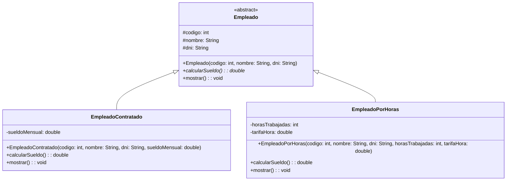
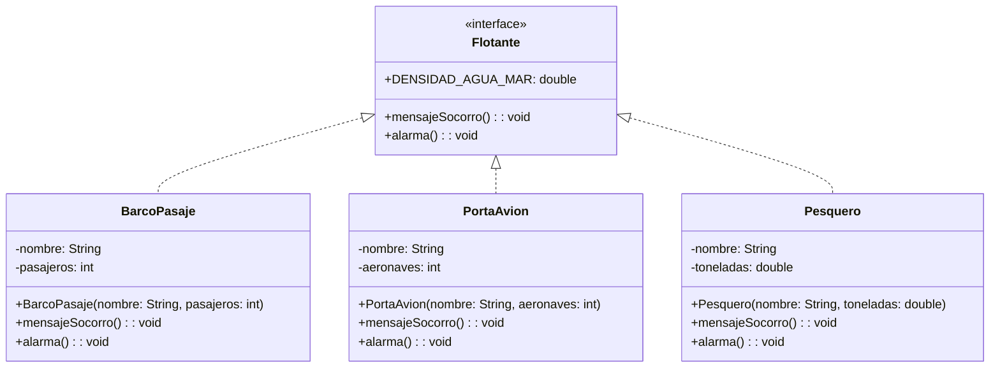
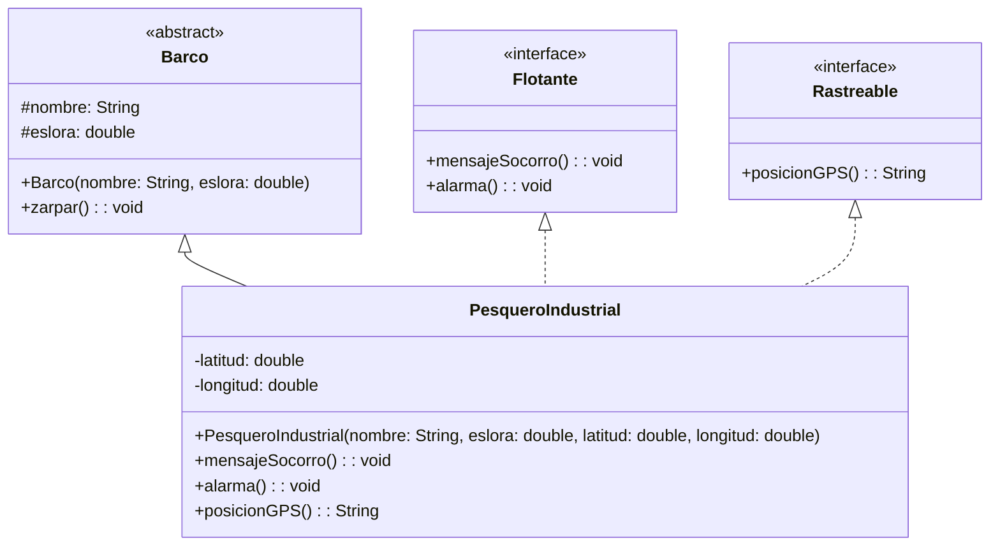
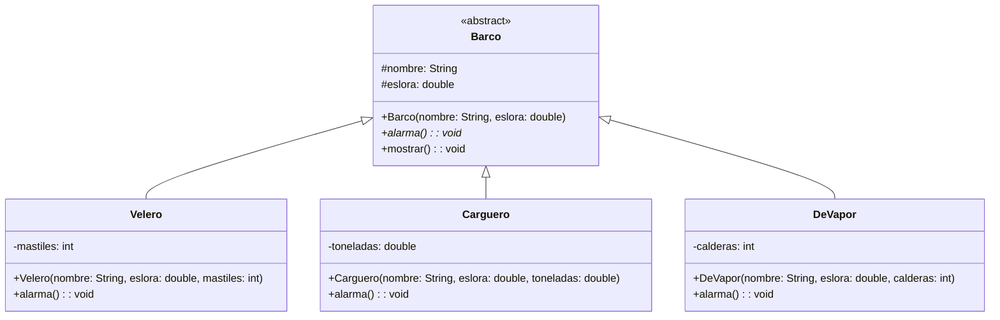
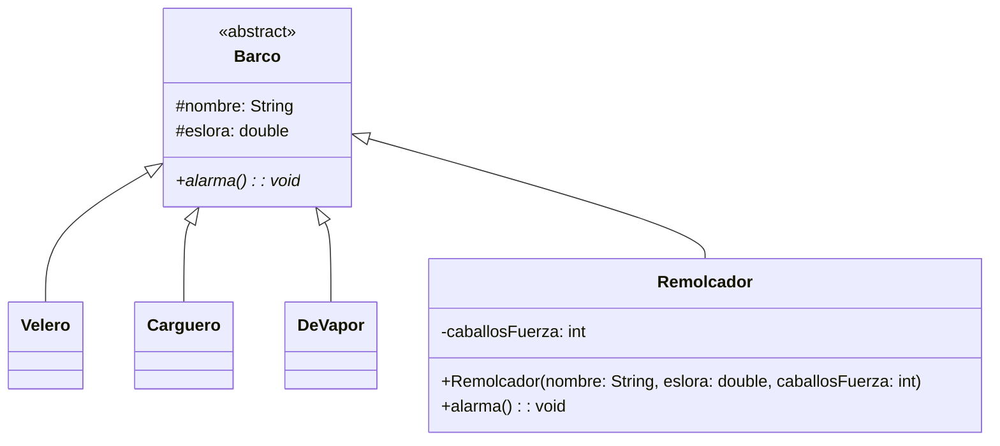
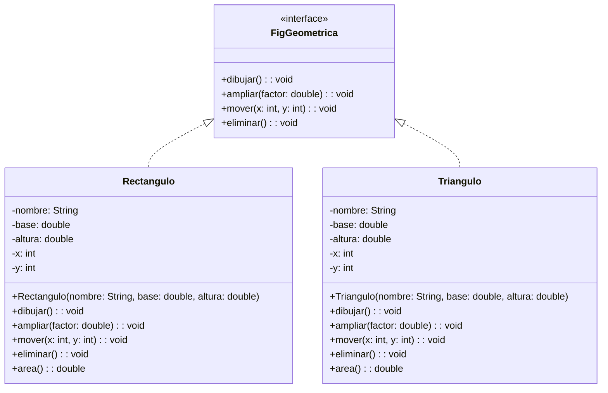
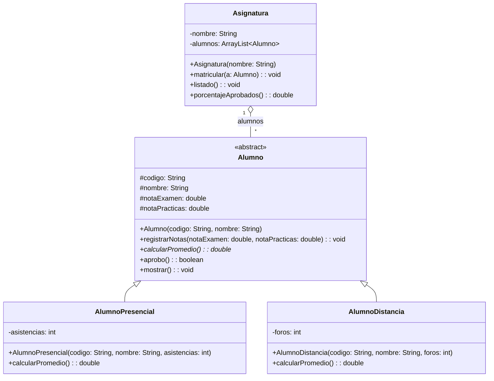
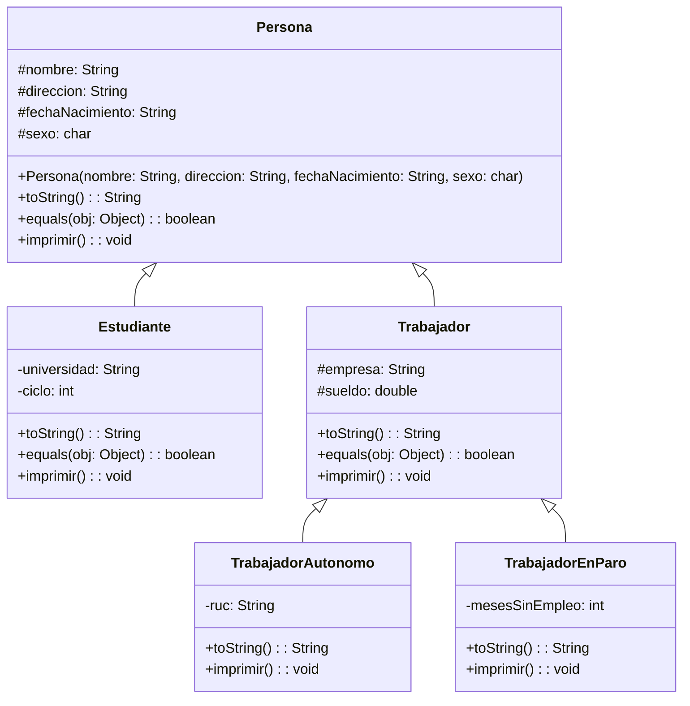
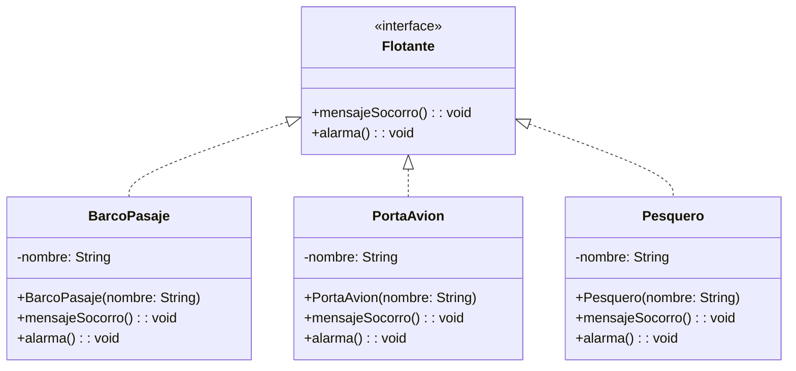
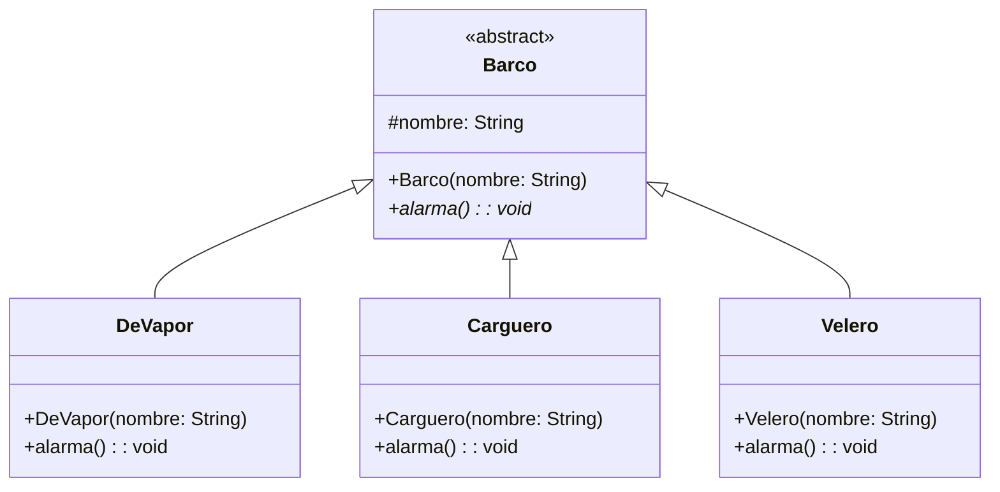

# USIL – Programación Orientada a Objetos I · Semana 11

## Clases abstractas, interfaces y polimorfismo: del diagrama UML al código Java

Código que acompaña la sesión de **clases abstractas e interfaces** y de **polimorfismo con enlace dinámico**.
Cada carpeta es un proyecto independiente con su propio `Main.java`.

👉 **Prácticas de clase paso a paso:** [`PRACTICAS_CLASE.md`](PRACTICAS_CLASE.md)

### Qué se trabaja en cada bloque

| Bloque | Tema | Carpetas |
|---|---|---|
| **1** | Clases abstractas e interfaces: `abstract`, `implements`, contratos | `EjemploResuelto01`–`EjemploResuelto03`, `Actividad01`, `Actividad02`, `Actividad04` |
| **2** | Polimorfismo, enlace dinámico y extensibilidad | `EjemploResuelto04`, `EjemploResuelto05`, `Actividad03`, `Actividad05` |

> En la Semana 10 viste la generalización: `extends`, `super(...)` y `@Override`. Esta semana la jerarquía es la misma, pero la clase base deja de poder instanciarse y pasa a **obligar**. Lo realmente nuevo son las **interfaces** y el **enlace dinámico**.

## Del diagrama al código (resumen)

| En el diagrama UML | En Java |
|---|---|
| Clase en *cursiva* o con `{abstract}` | `public abstract class Empleado` |
| Método en *cursiva* o con `{abstract}` | `public abstract double calcularSueldo();` (sin llaves, con punto y coma) |
| Estereotipo `«interface»` | `public interface Flotante` |
| Generalización `◁—` hacia una clase | `class Velero extends Barco` |
| Realización `◁- - -` hacia una interfaz | `class BarcoPasaje implements Flotante` |
| Una clase con dos realizaciones | `implements Flotante, Rastreable` |
| Método que aparece arriba **y** abajo | la subclase lo sobrescribe con `@Override` |
| Atributo heredado | `protected` en la superclase |
| Constante en una interfaz | `public static final` implícito: basta `double DENSIDAD = 1025.0;` |

**Cómo leer los diagramas:** se usa la notación UML estándar `visibilidad nombre: Tipo` (por ejemplo `-nombre: String`, `+mostrar() : void`). `-` es privado, `#` es protegido y `+` es público. Cada diagrama muestra **todas** las clases con los mismos atributos, constructores y métodos que tiene el código de su carpeta; en las diapositivas los diagramas van abreviados para que se lean proyectados.

**Las tres reglas de esta semana**

1. Una clase abstracta **no se puede instanciar**, pero sí se puede usar como **tipo de referencia**. Eso es justo lo que hace posible el polimorfismo.
2. Si cambias los parámetros, **no sobrescribes: sobrecargas**, y el polimorfismo deja de actuar.
3. El compilador verifica contra el **tipo de la referencia**; la JVM ejecuta el método del **objeto real**. Esa separación es el enlace dinámico.

---

# Bloque 1 · Clases abstractas e interfaces

## EjemploResuelto01 · Clase abstracta: `Empleado` – `EmpleadoContratado` – `EmpleadoPorHoras`

Es la **misma jerarquía de la Semana 10** (`EjemploResuelto04`), con un cambio decisivo: `Empleado` pasa a ser `abstract` y `calcularSueldo()` deja de devolver `0` para convertirse en un método abstracto. Ya no se puede crear un `Empleado` "genérico", y ninguna subclase puede olvidarse de definir su fórmula: el compilador no la deja.



**Salida**

```
Codigo: 1001 | Nombre: Ana Soto | DNI: 45871236
  Contratado - Sueldo: S/ 4500.0
Codigo: 1002 | Nombre: Luis Mena | DNI: 70125489
  Por horas - Sueldo: S/ 2000.0
Gasto total: S/ 6500.0
```

> **Compruébalo tú.** En el `Main` hay una línea comentada con `new Empleado(...)`. Descoméntala y compila: el error es `Empleado is abstract; cannot be instantiated`. Antes de esta semana, esa línea compilaba y devolvía un sueldo de `0.0` en ejecución. Ahora el error aparece **en compilación**, que es donde cuesta barato.

> **Ojo con la diapositiva.** En el material de clase el constructor aparece abreviado como `super(codigo, nombre)` para que la línea quepa proyectada. Aquí se conservan los **tres** atributos de la Semana 10 (`codigo`, `nombre`, `dni`) para que puedas comparar las dos versiones del mismo código lado a lado.

📁 [`EjemploResuelto01`](EjemploResuelto01)

## EjemploResuelto02 · Interfaz: `Flotante` – `BarcoPasaje` / `PortaAvion` / `Pesquero`

Las tres clases **no tienen nada en común**: ni atributos, ni código, ni una clase base. Lo único que comparten es que saben hacer dos cosas. Eso no es una jerarquía, es un **contrato**, y para eso existe `interface`.



**Salida**

```
Estrella del Sur: sirena continua y luces de emergencia
MAYDAY - Estrella del Sur con 320 pasajeros a bordo
Almirante Grau: zafarrancho de combate, 24 aeronaves aseguradas
SOS en clave militar - Almirante Grau
Dona Rosa: campana de cubierta y recogida de redes
MAYDAY - Dona Rosa con 18.5 t de captura
Densidad de referencia: 1025.0 kg/m3
```

> **Fíjate en el tipo del arreglo:** es `Flotante[]`, la interfaz. De cada elemento solo se sabe que cumple el contrato. Una interfaz no responde "qué es", responde "**de qué es capaz**".

📁 [`EjemploResuelto02`](EjemploResuelto02)

## EjemploResuelto03 · Múltiples interfaces: `extends` + `implements`

Java no permite heredar de dos clases, pero una clase **sí** puede firmar varios contratos. `PesqueroIndustrial` hereda de `Barco` y además se compromete con `Flotante` y `Rastreable`. La misma instancia se puede ver con **tres tipos distintos**.



**Salida**

```
Dona Rosa zarpa del puerto (32.5 m de eslora)
Dona Rosa: campana de cubierta
MAYDAY - Dona Rosa en -12.05, -77.15
Dona Rosa zarpa del puerto (32.5 m de eslora)
Dona Rosa: campana de cubierta
Posicion: -12.05, -77.15
```

> `extends` va **siempre primero**; `implements` después, separando las interfaces con coma. Una sola clase base, tantos contratos como haga falta.

📁 [`EjemploResuelto03`](EjemploResuelto03)

---

# Bloque 2 · Polimorfismo y enlace dinámico

## EjemploResuelto04 · Enlace dinámico: `Barco` – `Velero` / `Carguero` / `DeVapor`

El `Main` tiene dos partes. En la primera, **una sola referencia** `Barco b` apunta a dos objetos distintos y la línea `b.alarma()` —idéntica las dos veces— produce salidas diferentes. En la segunda, el arreglo polimórfico hace lo mismo en un bucle.



**Salida**

```
Albatros: bocina de aire, tres pitidos largos
Tramontana: sirena de carga, un pitido continuo
---
Independencia: silbato de vapor, dos pitidos
Tramontana: sirena de carga, un pitido continuo
Albatros: bocina de aire, tres pitidos largos
```

> **El tipo estático** es lo que ve el compilador (`Barco b`): solo verifica que `alarma()` exista en `Barco`. **El tipo dinámico** es lo que hay en memoria al ejecutar: eso decide qué versión se ejecuta. La línea de código no cambia; el objeto sí.

📁 [`EjemploResuelto04`](EjemploResuelto04)

## EjemploResuelto05 · Extensibilidad: agregar `Remolcador` sin tocar nada

La prueba de fuego del diseño polimórfico. Compara este `Main` con el de `EjemploResuelto04`: lo único que cambia es el contenido del arreglo. **El bucle es idéntico**, y las clases `Barco`, `Velero`, `Carguero` y `DeVapor` no se tocaron.



**Salida**

```
Independencia: silbato de vapor, dos pitidos
Tramontana: sirena de carga, un pitido continuo
Albatros: bocina de aire, tres pitidos largos
Bravo: bocina grave, dos pitidos cortos
```

> **Reutilización** es no repetir: lo común se escribió una sola vez en la clase base. **Extensibilidad** es crecer sin romper: el código cliente quedó cerrado a modificación y abierto a extensión. Si al agregar una clase tuviste que editar el bucle, el diseño aún no es polimórfico.

📁 [`EjemploResuelto05`](EjemploResuelto05)

---

## Actividades de la semana

Son los **tres casos de la actividad de aprendizaje de la Semana 11** (documento `(11-2) Actividad-1`) y los **dos ejercicios del material de clase**, una carpeta por caso.

| Carpeta | Origen | Caso | Qué debes hacer |
|---|---|---|---|
| [`Actividad01`](Actividad01) | Caso 01 | Interfaz `FigGeometrica` | Declarar el contrato y que `Rectangulo` y `Triangulo` lo firmen |
| [`Actividad02`](Actividad02) | Caso 02 | `Alumno` presencial y a distancia | Clase abstracta con `calcularPromedio()` abstracto, dos fórmulas distintas |
| [`Actividad03`](Actividad03) | Caso 03 | `Persona` y sus cuatro subclases | Redefinir `toString`, `equals` e `imprimir` en cada una |
| [`Actividad04`](Actividad04) | Ejercicio 01 de clase | Interfaz `Flotante` y tres barcos | Implementar el contrato con un mensaje propio por clase |
| [`Actividad05`](Actividad05) | Ejercicio 02 de clase | `Barco` abstracta y sus derivadas | Arreglo polimórfico y comprobar la extensibilidad |

> Los ejercicios **no compilan tal cual**: faltan los `TODO`. Es lo esperado.

### Actividad01 · Interfaz `FigGeometrica` (Caso 01 del documento oficial)

Un rectángulo y un triángulo no comparten código, pero sí comparten **lo que saben hacer**. Ese es el caso de uso exacto de una interfaz.



> `area()` **no está en la interfaz** a propósito: la fórmula es distinta en cada figura y ninguna de las dos la comparte con la otra. Pregúntate si debería estar o no, y por qué.

### Actividad02 · `Alumno` presencial y a distancia (Caso 02 del documento oficial)

Aquí sí hay código común —el código, el nombre, las notas, el `mostrar()`— así que la respuesta es **clase abstracta**, no interfaz. Lo único que cambia es la fórmula del promedio, y por eso es lo único abstracto.



> **Fíjate en `aprobo()`:** está en la clase abstracta y llama a `calcularPromedio()`, que **todavía no existe**. Funciona igual, porque en ejecución la JVM resolverá la llamada contra el objeto real. Es enlace dinámico dentro de la propia clase base.

### Actividad03 · `Persona` y sus subclases (Caso 03 del documento oficial)

Cuatro subclases y una jerarquía de dos niveles: `TrabajadorAutonomo` y `TrabajadorEnParo` heredan de `Trabajador`, no de `Persona`. Cuando llames a `super.toString()` desde ellas, lo que recibes ya trae empresa y sueldo.



> `Persona` **no es abstracta** en este caso: el enunciado pide que exista por sí sola. Compara esta decisión con la de `Alumno` en la Actividad02 y justifica por qué son distintas.

### Actividad04 · Interfaz `Flotante` (Ejercicio 01 del material de clase)



### Actividad05 · `Barco` abstracta (Ejercicio 02 del material de clase)



> El `TODO 5` te pide agregar un `Remolcador` al final. Si para que funcione tuviste que modificar el bucle del `TODO 4`, vuelve atrás: algo no quedó polimórfico.
